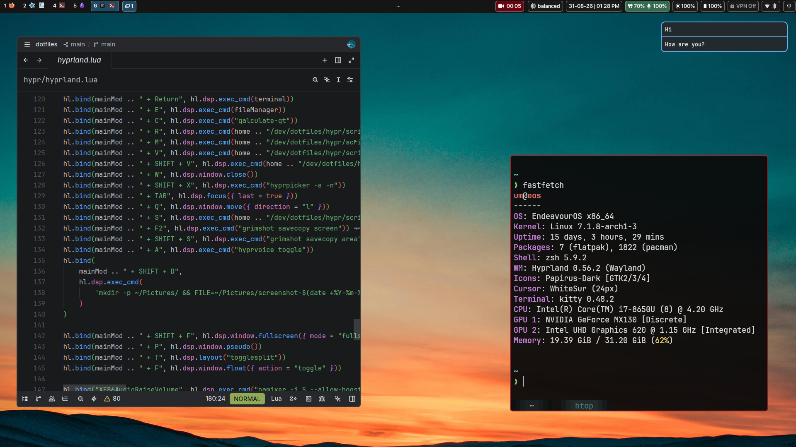

# dotfiles



Details about the setup:

- **OS**: Endeavour OS
- **WM**: [Hyprland](https://github.com/hyprwm/Hyprland)
- **Shell**: [zsh](https://wiki.archlinux.org/title/Zsh) with [Oh My Zsh](https://ohmyz.sh/)
- **Browser**: Firefox
- **Bar**: [waybar](https://github.com/Alexays/Waybar)
- **Shell Theme**: [Starship](https://starship.rs)
- **Terminal**: [Kitty](https://github.com/kovidgoyal/kitty)
- **Editor**: [Zed](https://zed.dev/)
- **Launcher**: [Rofi](https://github.com/davatorium/rofi)
- **Notification**: [Dunst](https://github.com/dunst-project/dunst)
- **Fonts & Other Packages**: See `pkgs.arch.txt` file

### Installation

Clone the repo to ~/dev/ (if you want to change the location then make sure to update the paths in `install-conf.sh` and `pkg-install.sh`)

```bash
mkdir -p ~/dev/

cd ~/dev/

git clone https://github.com/atanhx/dotfiles.git
```

The setup is split into two scripts:

- **`pkg-install.sh`** — installs packages. On Arch it uses your AUR helper (`yay`/`paru`) with `pkgs.arch.txt` + `other_pkgs.arch.txt`. The same script also supports Debian/Ubuntu (`pkgs.deb.txt`) and Fedora (`pkgs.rpm.txt`); the package lists for those live in this repo too.
- **`install-conf.sh`** — symlinks/links the config folders/files into `~/.config` and `~`, sets up Oh My Zsh + zoxide, and fixes the XDG menu.

---

#### Arch (Endeavour OS, etc.)

Before installing, have a look at the `pkgs.arch.txt` file.

```bash
## Packages in pkgs.arch.txt / other_pkgs.arch.txt are Arch-only and pulled via an AUR helper.
yay -S $(cat ~/dev/dotfiles/pkgs.arch.txt other_pkgs.arch.txt | grep -v '^$')
```

Or just use the helper script which detects Arch and runs the AUR helper:

```bash
chmod +x ~/dev/dotfiles/pkg-install.sh
~/dev/dotfiles/pkg-install.sh
```

---

#### Link your configs

After packages are installed, symlink the configs:

```bash
# Note that this is an optional step. If you don't want to use it then you can manually copy paste the files like normal.
chmod +x ~/dev/dotfiles/install-conf.sh

~/dev/dotfiles/install-conf.sh
```

After running this, it will:

- Create symlinks for the current config directories in this repo.
- Link the home dotfiles currently tracked in this repo, including `.zshrc`.
- Install Oh My Zsh with the official installer if `zsh` and `curl` are available and `~/.oh-my-zsh` does not exist yet.
- Let the Oh My Zsh installer switch your default login shell to `zsh`.
- Fix the XDG menu (uses `archlinux-xdg-menu` on Arch).

Oh My Zsh is not installed from `pkgs.arch.txt`; it is bootstrapped by the install script using the official installer script.

Tada! now you've installed the theme.

You can switch your session and see if it works!

> **NOTE**
>
> You may need to adjust the screen resolution and waybar widgets postion manually as they are _**most**_ likely to change on your device.
